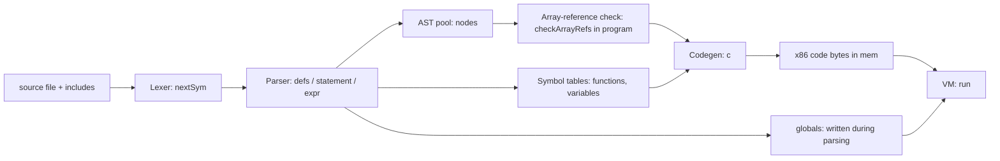

# Technical overview: compilation and VM execution

The compiler generates real 32-bit x86 machine code and writes it, together with the global data, into one memory array `mem[]`. `run()` in `mc-vm.c` then interprets that code. The VM decodes the same x86 subset the compiler emits, using the real Intel encodings, so the bytes can later be written to an executable unchanged. The pipeline is:



## Source layout

- `mc-main.c`: defines the `main()` function.
- `mc.h`: shared types, structures, sizes, and defines
- `mc-lex.c`: tokenization, the source/include stack, and error reporting.
- `mc-parse.c`: AST nodes, function and variable tables, global variable storage, and program checks.
- `mc-gen.c`: x86 code generation and call patching.
- `mc-vm.c`: the x86 decoder and `run()` interpreter, with `mem[]`, `loadInt()` and `storeInt()`.
- `mc-list.c`: the code listing. Option `-l` writes a disassembly of the generated code to `listing.txt`. `make test-listing` checks that listing against `listing-expected.txt`.
- `lib/*.mc`: min-c source libraries included by programs, not C headers. `strcatc` does not check capacity, so the array must have room for the new character and the terminating zero. 

## 1. Lexer

- `nextCh()` reads from `inputFp` and counts newlines in `lineNumber`.
- `nextSym()` produces token codes such as `ID`, `INT`, `STRING_LITERAL`, `PLUS_PLUS`, and `RETURN_SYM`. `++` and `--` are single tokens, so `a--b` is a syntax error; write `a - -b`.
- Keywords are matched against `reservedWords[]`, and each keyword's token value is its index there, so `reservedWords[]` and the `*_SYM` enum in `mc.h` must stay in the same order. Reserved words are `do`, `else`, `if`, `while`, `void`, `int`, `byte`, `emit`, and `return`. `emit` is a keyword, so using it as a name is a syntax error. Only `//` line comments are skipped. Character and string literals support a fixed escape set.
- `#include "path"` is a directive handled in `nextSym()`, which calls `includeFile()` instead of returning a token. `includeFile()` splices the named file's text in place. Paths resolve relative to the including file's directory, and each joined path is read once. `closeSource()` returns to the includer at EOF.
- `qFail(cond, msg)` prints `path:line:` before every compile error.
- The input file is a required command-line argument; see the command line section of `README.md`.

## 2. Parser: builds an AST, not code

- `defs()` handles top-level globals and functions. `variableDeclarations()` handles global `int` and `byte` scalars and arrays, including string initializers. A global scalar initializer is parsed as an expression, converted for `byte` globals, and must fold to a constant at parse time; a non-constant initializer is a compile error.
- `parseFunctionDefinition()` records each function in `functions[]`, including its return type, parameter types and array flags, locals, and body. A prototype (a header ending in `;`) records the same signature without a body. A function's index is assigned on first reference, but a call must follow a prototype or definition of that function.
- Statements and expressions become `node` structs in the fixed pool `nodes[MAX_NODES]`. Each node has a `kind`, up to three children (`o1`, `o2`, `o3`), and a `val`.
- Locals are resolved to frame slots at parse time. Parameters use negative `val` (`-index-1`) to distinguish them from globals. Int and byte globals both live in `mem[]`, addressed by byte offset. Int scalars and int array elements take 4 bytes, read and written by `loadInt`/`storeInt`; byte globals and byte array elements take one byte each. The parser records each scalar or array element's `int`/`byte` type for conversions and array argument checks.
- Local slots follow the parameters in a function frame. Their encoded local index includes the function's parameter count; parameter indexes are relative to the start of the frame.
- Each `statement()` call builds one node tree, for example `IF1`, `WHILE`, `DO`, `SEQ`, `EXPR`, `RETURN_NODE`, or `VOID_RETURN`.
- A local declaration with an initializer becomes a `SET` to the local, wrapped in `EXPR` and sequenced with `SEQ`. `byte` locals convert the value first. The initializer runs each time the declaration executes, so it works inside loops.
- Arithmetic operators (`+ - * / %`) have no precedence. `sum()` applies them strictly left to right, so `2 + 3 * 4` is `20`. Use parentheses to change the order. Assignment is a statement, not an expression: `statement()` parses an expression, and if it is followed by `=`, `assignment()` requires a `VAR`, `LOCAL`, or `ARRAY_GET` target. `a = b = 1;`, `if (a = 1)`, and `emit(a = 1)` are syntax errors.
- Unary minus is lowered to `0 - term`. Integer literals are never negative.
- `x++`, `x--`, `++x`, and `--x` apply to scalar locals, parameters, and globals. The parser builds `POST_INC` or `PRE_INC` nodes; postfix yields the old value and prefix the new. Applying them to arrays or literals is an error.
- Comparison operators (`<`, `>`, `<=`, `>=`, `==`, `!=`) produce `1` when true and `0` when false.

## 3. Program-level checks (`program()`)

- A `main` must exist, must take no parameters, and must return `int` or `void`.
- Every declared function must be defined. A call must follow a prototype or definition of its function.
- A repeated prototype or definition must match the earlier declaration's return type, parameter types, and array flags; parameter names may differ.
- A global variable and a function may have the same name. `f = ...` assigns the variable and `f(...)` calls the function.
- Parse errors report the line the lexer has reached, which can be one line past the offending token when that token ends a line. Errors found after parsing (validation and code generation, for example a void call used as a value) report the position where parsing stopped, not the offending line.
- `callArguments()` checks call arity, argument kinds (scalar or array), and array element types against the callee's declared signature.
- `checkArrayRefs()` rejects array references anywhere except as direct array arguments.
- `prog->o1` is set to `main`'s body.

Strings are lexed into `stringValues[]`, then materialized during parsing. `allocateStringLiteral()` reserves anonymous global byte storage laid out as `[length low byte, length high byte, chars..., 0]` and writes it directly into `mem[]`.
String literals are permitted only as array arguments or global array initializers. Explicitly sized string-initialized arrays must fit the 2-byte length, all characters, and the terminating zero.

## 4. Code generation (`c()` walks the AST)

The output is x86 machine code written to `mem[]` from `CODE_BASE` (0x400000) upward. Each instruction uses its real Intel encoding, so the bytes can later be written to an executable unchanged. Only the subset listed below is emitted. Code generation is done in one pass over the AST, with forward jumps and calls patched afterward.

The code starts with an entry stub that calls `main` and passes its result to the exit system call:

```
call main        ; E8 rel32, patched by patchCalls()
mov ebx, eax     ; exit status
mov eax, 1       ; sys_exit
int 0x80
```

Each function is emitted in index order. Its shape is:

```
push ebp
mov ebp, esp
mov eax, 0       ; then one "push eax" per local, which zeroes the locals
push eax
...
<body>
mov eax, 0       ; falling off the end returns 0
leave
ret
```

Instructions used by the generator:

| Construct | Emitted code |
|---|---|
| Constant | `mov eax, imm32` |
| Parameter or local read or write | `mov eax, [ebp+disp32]` / `mov [ebp+disp32], eax` |
| Global `int` read or write | `mov eax, [addr32]` / `mov [addr32], eax` (absolute address, no base register) |
| Global `byte` read or write | `movzx eax, byte [addr32]` / `mov [addr32], al` |
| Array element (read) | Evaluate the index into `eax`. For an `int` array, `shl eax, 2`. For a global array, `add eax, imm32` (the base address). For an array passed as a parameter, `mov ecx, eax`, load the base into `eax` from `[ebp+disp32]`, then `add eax, ecx`. Then `mov eax, [eax]`, or `movzx eax, byte [eax]` for `byte`. |
| Array element (store) | Compute the address as above, `push eax`, evaluate the value into `eax`, `pop ecx`, then `mov [ecx], eax` (or `mov [ecx], al`) |
| Binary `+ - *` | Left operand to `eax`, `push eax`, right operand to `eax`, `mov ecx, eax`, `pop eax`, then `add`, `sub`, or `imul eax, ecx` |
| `/` and `%` | The operands as above, then `cdq` and `idiv ecx`. `%` finishes with `mov eax, edx`. |
| Comparison | The operands as above, then `cmp eax, ecx`, `setcc al`, `movzx eax, al` (`setl`, `setg`, `setle`, `setge`, `sete`, `setne`) |
| Increment or decrement | Load, `add eax, imm32` (negative for `--`), `movzx eax, al` for `byte`, then store. Post-increment `push`es the old value and `pop`s it back, so the value is the old one. |
| Byte conversion | `movzx eax, al` |
| Control flow | `test eax, eax`, then `jz` or `jnz rel32` (`0F 84` / `0F 85`). `while` and `do` use `jmp rel32` for the back edge. Forward targets are holes patched by `fix()`. |
| Call | Each argument is evaluated and pushed, then `call rel32`, then `add esp, 4*n` to remove the arguments. The result is in `eax`. |
| Return | Evaluate the value into `eax`, then `leave` and `ret`. `return;` in a `void` function uses the same epilogue. |
| Built-in `emit` | `push eax` (the byte is at `[esp]`), `mov ecx, esp`, `mov edx, 1`, `mov ebx, 1`, `mov eax, 4`, `int 0x80`, `pop eax`, `movzx eax, al`. The expression value is the byte, as before. |
| Program end | Entry stub as above |

Notable generation details:

- Every expression leaves its value in `eax`. Statements leave the stack as they found it, so `push`/`pop` pairs stay inside a single expression.
- A call's arguments stay on the stack until the call returns, when `add esp, 4*n` removes them.
- Forward jumps and calls are emitted as holes (4-byte fields) and patched once the target is known. `WHILE` and `DO` back edges are emitted with their known target.
- Constant-only arithmetic and comparisons are folded at compile time by the parser's `gen()`. Division and modulo by zero are not folded, so they still fail at runtime.
- Call targets are unknown when the call is emitted, so each call is recorded in `callFixups[]`. `patchCalls()` fills in each `rel32` after all functions are generated.
- Jump and call displacements are `rel32`, measured from the end of the 4-byte field. `fix()` computes them.
- Frame layout: a parameter `i` of `n` is at `[ebp+8+4*(n-1-i)]`, because the caller pushes arguments left to right. Local `j` is at `[ebp-4*(j+1)]`.
- Operands are 4-byte values in little-endian byte order, which is native on x86.
- Every value is a 32-bit `int`. `byte` values are 0..255. Byte locals and parameters take a 4-byte slot. Byte globals and array elements take one byte of memory.
- `emit` uses the `write` system call (number 4) on fd 1, so its output goes to stdout.

## 5. The memory image

One array, `mem[MEM_BYTES]`, holds everything:

| Region | Address | Contents |
|---|---|---|
| Globals | `0 .. numGlobalBytes` | Global `int` and `byte` storage, string literals, and array data. The C runtime zero-initializes this array. |
| Code | `CODE_BASE` (0x400000) .. `here` | The entry stub and the functions. `here` is the next free byte. |
| Stack | `CODE_TOP` .. `MEM_BYTES` | Grows down from `MEM_BYTES`. `esp` starts at `MEM_BYTES`. |

The layout is set in [mc.h](/home/chris/code/mc/mc.h): `CODE_BASE` is `MAX_GLOBAL_BYTES`, `CODE_TOP` is `CODE_BASE + MAX_CODE`, and `MEM_BYTES` is `CODE_TOP + STACK_BYTES`.

The `-l` listing gives each instruction's address, its bytes, and its mnemonic, with a label line before each function. The disassembler in [mc-list.c](/home/chris/code/mc/mc-list.c) decodes only the encodings the code generator emits. `objdump` reads the same image as a cross-check:

```
dd if=a.img bs=1 skip=8 count=<codeSize> of=code.bin
objdump -D -b binary -m i386 -M intel code.bin
```

Values in `mem[]` are read and written with `loadInt()` and `storeInt()`, which check each address (see [6. Runtime checks](#runtime-checks)).

## 6. How the VM runs

`run()` in `mc-vm.c` is an x86 decoder and interpreter for the subset in section 4. It has no loader or relocation step. It runs the code at `CODE_BASE` in `mem[]`, starting with the entry stub.

### Machine state

| State | Declaration | Purpose |
|---|---|---|
| Registers | `struct cpu_s`, `reg[8]` | `eax` through `edi`, using the x86 numbering. `esp` starts at `MEM_BYTES`. |
| Program counter | `pc` | Address of the next instruction in `mem[]`. |
| Flags | `flagA`, `flagB` | The operands of the last `cmp` or `test`. Conditions are evaluated from these two values. Arithmetic does not set flags. |
| Memory | `mem[MEM_BYTES]` | Globals, code, and the stack, as in section 5. |

### Dispatch loop

- `run()` reads one opcode byte at `pc` and decodes it with a `switch`.
- Two-byte opcodes start with `0F`: `0F 8x` is a conditional jump, `0F 9x` is `setcc`, `0F AF` is `imul`, and `0F B6` is `movzx`.
- Instructions with a ModRM byte are decoded by `decodeModRM()`. One ModRM case handles several operand forms, so the switch needs one case per opcode, not per operand form.
- Supported ModRM forms are `[reg]` (mod 00), `[disp32]` (mod 00, rm 101), `[reg+disp32]` (mod 10), and register-direct (mod 11). SIB (rm 100) and `disp8` (mod 01) are rejected with `-unsupported x86 addressing-`. The generator does not emit them.
- Byte-register operands are limited to `al`, `cl`, `dl`, and `bl` (registers 0 to 3). Others are rejected.

### Calls and returns

- `call rel32` pushes the return address and jumps. `ret` pops it.
- `push ebp` and `mov ebp, esp` set up the frame, and `leave` restores it, as in the x86 convention.
- `push` and `call` check that `esp` stays above `CODE_TOP`, so a deep recursion fails with `-stack overflow-`.

### Built-in services

`int 0x80` is the system call interface. Only these calls are supported:

- `eax = 1` is `exit`, with the status in `ebx`. `run()` returns that status.
- `eax = 4` is `write`. Only fd 1 is supported, and the bytes go to stdout with `fwrite`.

Any other call stops with `-unsupported system call-`. Syscall numbers are the Linux i386 ones, so this is the layer that a native executable would replace with a real kernel call.

### Runtime checks

- Every load and store checks its address against `MEM_BYTES`, so an out-of-range access fails with `-bad memory address-`. The check covers wild pointers into code or the stack, which a bad array index can now reach.
- `esp` may not drop below `CODE_TOP`, so a runaway recursion fails with `-stack overflow-`.
- `idiv` stops on a zero divisor with `-divide by zero-`, which covers both `/` and `%`. It also checks for quotient overflow (`-divide overflow-`).
- Unsupported instructions, operands, condition codes, and system calls stop with a message that names the opcode or field.


## 7. Limitations

- **Fixed limits.**
  - `ID_NAME_LENGTH` is 24. Used for variable and parameter names.
  - `MAX_CODE` is 131072 bytes of machine code.
  - `MAX_NODES` is 16384 AST nodes.
  - `MAX_FUNCTIONS` is 1024 functions.
  - `MAX_GLOBAL_NAMES` is 1024 global variable names.
  - `MAX_GLOBAL_BYTES` is 4194304 bytes, shared by `int` and `byte` globals.
  - `MAX_STRING_LENGTH` is 1024 characters.
  - `MAX_PATH_LENGTH` is 64 chars.
  - `MAX_INCLUDE_DEPTH` is a stack for 16 files.
  - `MAX_INCLUDED_FILES` is 128 files.
  - `MAX_CALL_FIXUPS` is the same as `MAX_NODES`.
  - `MAX_LOCALS` is 32 per function.
  - `MAX_PARAMETERS` is 32 per function.
  - `STACK_BYTES` is 65536 bytes of stack, shared by the call frames and the pushed operands.

- **Local variables.** Locals are scalars only. Local arrays are not supported.
