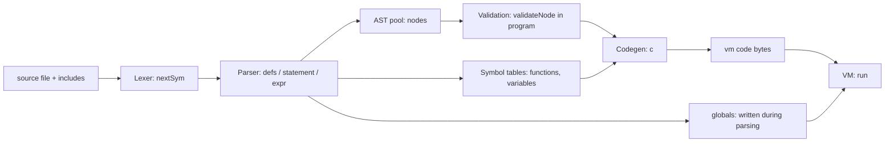

# Technical overview: compilation and VM execution

The compiler does not write an image file. It builds a bytecode array `vm[]` and fills `globals[]` and `globalBytes[]` in memory, then `run()` in `vm.c` executes that array directly. The pipeline is:

## Source layout

- `tiny-c.c`: includes `tiny-c.h`, then `lexer.c`, `parser.c`, `gen.c`, and `vm.c` in that order; defines `compile()` and `main()`. It is the only file the makefile compiles. The module files are `#include`d into it, so the whole compiler is one translation unit and the modules share its globals and functions without `extern` declarations.
- `tiny-c.h`: shared limits (including `ID_NAME_LENGTH` and `STACK_SIZE`), token/node/opcode definitions, the `node` and `function_s` structs, the `byte` typedef, and VM macros.
- `lexer.c`: tokenization, global variable storage, the source/include stack, and error reporting.
- `parser.c`: AST nodes, function and variable tables, and program checks.
- `gen.c`: bytecode generation, constant folding, and call patching.
- `vm.c`: the `run()` interpreter.
- `lib/*.tc`: Tiny-C source libraries included by programs, not C headers. `strcatc` does not check capacity, so the array must have room for the new character and the terminating zero. `dis.c` is an unused, out-of-date disassembler, and it is entirely commented out.

## 1. Lexer

- `nextCh()` reads from `inputFp`, or stdin if it is null, and counts newlines in `lineNumber`.
- `nextSym()` produces token codes such as `ID`, `INT`, `STRING_LITERAL`, `PLUS_PLUS`, and `RETURN_SYM`. `++` and `--` are single tokens, so `a--b` is a syntax error; write `a - -b`.
- Keywords are matched against `reservedWords[]`, and each keyword's token value is its index there, so `reservedWords[]` and the `*_SYM` enum in `tiny-c.h` must stay in the same order. `include` is a keyword, and when `nextSym()` sees it, it calls `includeFile()` instead of returning a token. Reserved words are `do`, `else`, `if`, `while`, `void`, `int`, `byte`, `emit`, `return`, and `include`. `emit` is a keyword, so using it as a name is a syntax error. Only `//` line comments are skipped. Character and string literals support a fixed escape set.
- `include "path";` is handled in the lexer. `includeFile()` splices the named file's text in place. Paths resolve relative to the including file's directory, and each joined path is read once. `closeSource()` returns to the includer at EOF.
- `fail()` prints `path:line:` before every compile error.
- The default input opened by `main()` is `unit-tests.tc`; a command-line path selects another input file.

## 2. Parser: builds an AST, not code

- `defs()` handles top-level globals and functions. `variableDeclarations()` handles global `int` and `byte` scalars and arrays, including string initializers. A global scalar initializer is parsed as an expression, converted for `byte` globals, and folded at parse time by `fold()` in `gen.c`; a non-constant initializer is a compile error.
- `parseFunctionDefinition()` records each function in `functions[]`, including its return type, parameter types and array flags, locals, and body. A function's index is assigned on first reference, so calls can precede definitions.
- Statements and expressions become `node` structs in the fixed pool `nodes[MAX_NODES]`. Each node has a `kind`, up to three children (`o1`, `o2`, `o3`), and a `val`.
- Locals are resolved to frame slots at parse time. Parameters use negative `val` (`-index-1`) to distinguish them from globals. Int globals use absolute slot numbers in `globals[]`; byte globals and byte arrays use byte offsets in `globalBytes[]`. The parser records each scalar or array element's `int`/`byte` type for conversions and array argument checks.
- Local slots follow the parameters in a function frame. Their encoded local index includes the function's parameter count; parameter indexes are relative to the start of the frame.
- Each `statement()` call builds one node tree, for example `IF1`, `WHILE`, `DO`, `SEQ`, `EXPR`, `RETURN_NODE`, or `VOID_RETURN`.
- A local declaration with an initializer becomes a `SET` to the local, wrapped in `EXPR` and sequenced with `SEQ`. `byte` locals convert the value first. The initializer runs each time the declaration executes, so it works inside loops.
- Arithmetic operators (`+ - * / %`) have no precedence. `sum()` applies them strictly left to right, so `2 + 3 * 4` is `20`. Use parentheses to change the order. `expr()` accepts assignment only when the left side is `VAR`, `LOCAL`, or `ARRAY_GET`.
- Unary minus is lowered to `0 - term`. Integer literals are never negative.
- `x++`, `x--`, `++x`, and `--x` apply to scalar locals, parameters, and globals. The parser builds `POST_INC` or `PRE_INC` nodes; postfix yields the old value and prefix the new. Applying them to arrays or literals is an error.
- Comparison operators (`<`, `>`, `==`, `!=`) produce `1` when true and `0` when false.

## 3. Program-level checks (`program()`)

- A `main` must exist, must take no parameters, and must return `int` or `void`.
- Every called function must be defined.
- A global variable and a function may have the same name. `f = ...` assigns the variable and `f(...)` calls the function.
- Parse errors report the line the lexer has reached, which can be one line past the offending token when that token ends a line. Errors found after parsing (validation and code generation, for example a void call used as a value) report the position where parsing stopped, not the offending line.
- Call arity is checked against each function's parameter count.
- `validateNode()` and `validateCall()` check that array references appear only as array arguments, and that array element types match.
- `returnsOnAllPaths()` checks that `int` and `byte` functions return on every path. Only `return`, statement sequences, `if`/`else`, and `do` bodies count; a `while` loop never does, so `while (1) { return 1; }` is rejected.
- `prog->o1` is set to `main`'s body.

Strings are lexed into `stringValues[]`, then materialized during parsing. `allocateStringLiteral()` reserves anonymous global byte storage laid out as `[length low byte, length high byte, chars..., 0]` and writes it directly into `globalBytes[]`.
String literals are permitted only as array arguments or global array initializers. Explicitly sized string-initialized arrays must fit the 2-byte length, all characters, and the terminating zero.

## 4. Code generation (`c()` walks the AST)

The output is a flat byte array `vm[MAX_CODE]` (65536 bytes). Opcodes are one byte, followed by fixed-size operands:

| Construct | Emitted code |
|---|---|
| Global read/write | `IFETCH` / `ISTORE` + 4-byte slot |
| Local read/write | `LLOAD` / `LSTORE` + 4-byte frame slot |
| Parameter read/write | `PLOAD` / `PSTORE` + 4-byte index |
| Int array element | `IAFETCH`/`IASTORE` (global base) or `PAFETCH`/`PASTORE` (base taken from a parameter) |
| Byte global / byte array element | `BGET`/`BSET`, `BAFETCH`/`BASTORE` (global base) or `PBAFETCH`/`PBASTORE` (base from a parameter); these address `globalBytes[]` |
| Constants | `IP1` (0 to 127), `IP2` (128 to 32767), `IP4` (other `int` values) |
| Arithmetic and comparison | `IADD` to `INE` (operands already on the stack) |
| Control flow | `JZ`, `JNZ`, `JMP` with 4-byte signed relative offsets, patched via `hole()` and `fix()` |
| Call | `ICALL` + 4-byte address + 4-byte argc + 4-byte locals count (13 bytes total) |
| Return | `IRET` |
| Built-in `emit` | `SYS` + `SYS_EMIT` |
| Fused increment | `LINC`, `LDEC` (local or parameter slot) and `GINC`, `GDEC` (global slot) each take only a 4-byte slot and add or subtract one. They are used for `++` and `--` on `int` variables in statements and in expressions: postfix loads the old value first, then steps, and prefix steps first, then loads. `byte` variables use load, add, narrow (`I2B`), and store. |
| Byte conversion | `I2B` narrows the stack value to unsigned 8-bit `byte` (0 to 255) |

Notable generation details:

- Forward jumps are emitted as holes and patched once the target address is known. `WHILE` and `DO` back-jumps are emitted directly.
- Constant-only arithmetic and comparisons are folded at compile time by `fold()`. Division and modulo by zero are not folded, so they still fail at runtime.
- Call targets are unknown when the call is emitted, so each call is recorded in `callFixups[]`. `patchCalls()` fills in the addresses after all functions are generated.
- Every function leaves exactly one value on the operand stack when it returns. An explicit `return;` in a `void` function and the implicit fall-through return both produce `0`. Calls used as statements discard the returned value with `IDROP`.
- Program layout: `PROG` emits a call to `main`, then `IDROP`, then `HALT`, then each function body in index order, each ending with `IRET`.
- `IP2` immediates are 16-bit `short` values, used only for constants from 128 to 32767. Slot, base, jump, and call operands, and `IP4` immediates, are 4-byte native C `int` values. The configured Linux build uses `-m32`; the Visual Studio project supports Win32 and x64. These targets use 32-bit `int`, and the bytecode representation assumes that width and the target's native byte order.

## 5. The "VM image" in memory

- `vm[]`: the code bytes, starting with the call to `main`.
- `globals[]`: global `int` values. The C runtime zero-initializes this static array.
- `globalBytes[]`: global `byte` scalars and `byte` array elements, one byte each. Parsing writes string initializer data into it.
- `numGlobalSlots`: the number of global `int` slots in use.
- `numGlobalBytes`: the number of bytes in use in `globalBytes[]`.
- VM values and global slots use C `int` (32 bits on the configured Linux and Visual Studio targets). `byte` values are unsigned 8-bit values (0 to 255). Global `byte` storage is byte-sized in `globalBytes[]`; `byte` locals and parameters use int stack slots. Generated conversions narrow on assignment, parameter passing, return, and array stores, while reads promote back to `int`. Character literals remain int-valued, and casts are not supported. Scalar initializers are supported: global ones are folded at parse time, and local ones compile to assignments at the declaration point.

`run()` in `vm.c` starts the interpreter by:

1. Setting `pc = vm` and `sp = 0`.
2. Running the dispatch loop until `HALT`, or until `IRET` with an empty return stack.

Each call frame lives on the operand stack. Arguments are already pushed in order, so the frame starts at the first argument; local slots follow the arguments. These local slots are reserved by advancing `sp`, but are not initialized. A return-state struct records the return `pc` and the caller's `frameBase`.

## 6. How the VM runs

The VM is a stack machine implemented by `run()` in `vm.c`. It has no separate loader or relocation step. The code it executes is the `vm[]` array produced by the compiler.

### Machine state

| State | Declaration | Purpose |
|---|---|---|
| Operand stack | `int st[STACK_SIZE]` (1024), index `sp` | Holds intermediate values, call frames, and locals. `TOS` is `st[sp]`, `NOS` is `st[sp-1]`. |
| Globals | `globals[]` | Program-wide `int` variables and arrays; static storage starts at zero. |
| Byte globals | `globalBytes[]` | Program-wide `byte` variables and arrays, one byte per element; string initializers are written by the compiler. |
| Frame base | `frameBase` | Index in `st[]` of the current frame's first parameter or local. |
| Return stack | `struct return_s returnStack[STACK_SIZE]` (1024), `returnSp` | Saved return `pc` and caller `frameBase` for each active call. |

### Dispatch loop

When `run()` is called from `tiny-c.c`'s `main()`, it sets `pc = vm` and `sp = 0`. The first instruction calls `main`.

- `run()` reads one opcode at `*pc++` and jumps to its case in a `switch`.
- `ACASE` is `goto again; case`, so each case ends by jumping back to the top of the loop.
- Operands follow the opcode inline. Slot, base, jump, and call operands are decoded with `f4(pc)` (`*(int*)pc`), `IP2` immediates with `f2(pc)` (`*(short*)pc`), and `IP4` immediates with `*(int*)pc`.
- Jumps are relative. `JMP`, `JZ`, and `JNZ` read a 4-byte offset (using f4(pc)) and add it to the operand address.
- `JZ` (JMP if zero) and `JNZ` (JMP if not zero) pop the condition from the stack. Zero means FALSE, non-zero means TRUE.

### Calls and returns

- `ICALL` reads the target address, argument count, and local count. It checks the call/operand stack limits, saves the return `pc` (`pc + 12`) and caller's `frameBase`, then sets `frameBase` to the first argument's slot (or the next free slot for a call with no arguments). The arguments are not copied: they remain in place on `st[]`. It reserves the local slots by advancing `sp`; **it does not zero them**. A local must be assigned before it is read; reading an uninitialized local has undefined behavior.
- `IRET` takes the function result from `TOS`, writes it to `st[frameBase]`, and sets `sp` to `frameBase`. This discards the frame's remaining arguments and locals while leaving the result in place as the call expression's value. It then restores the caller's `pc` and `frameBase`. This same return convention is used for integer results and the zero returned by void functions.
- A `return;` in a void function emits zero followed by `IRET`. If execution reaches the end of any function body, generated code likewise emits zero followed by `IRET`. Integer functions are checked by the parser for a return on all paths.
- `HALT` returns from `run()` directly.

### Built-in services

`SYS` followed by `SYS_EMIT` passes the top-of-stack value to `putchar` as a character. The stack value is replaced with `putchar`'s return value, so `emit` is an expression.

### Runtime checks

- Return-stack overflow (`STACK_SIZE`, 1024 entries) and call-frame overflow stop with an error at `ICALL`. Operand-stack pushes inside an expression are not checked, so a sufficiently deep expression writes past the 1024-entry array.
- `IDIV` and `IMOD` stop on a zero divisor.
- `SYS_EMIT` expects one value on the stack.
- Array indexes are not checked at runtime, so a bad index reads or writes an arbitrary `globals[]` slot or `globalBytes[]` byte.
- Stack underflow is not checked for most opcodes.

## 7. Limitations

- **Fixed limits.**
  - `MAX_CODE` is 65536 bytes
  - `MAX_NODES` is 16384
  - `MAX_FUNCTIONS` is 1024
  - `MAX_NAMES` is 2048 global names
  - `MAX_GLOBAL_SLOTS` is 256000 `int` slots
  - `MAX_GLOBAL_BYTES` is 256000 bytes
  - `MAX_STRING_LENGTH` is 1024 characters
  - `MAX_LOCALS` is 256 per function
  - `MAX_PARAMETERS` is 64 per function
  - `MAX_CALL_FIXUPS` is `MAX_NODES`
  - the VM operand stack and return stack are each `STACK_SIZE` (1024) entries.
- **Local arrays.** Locals are scalars only. `int` and `byte` local declarations do not accept `[...]`.
- **Names and literals.** Identifiers are limited to 63 characters (`ID_NAME_LENGTH` is 64, including the terminating zero). Integer literals are not range-checked, so overflow is not detected.
- **Include limits.** `MAX_INCLUDE_DEPTH` is 16 and `MAX_INCLUDED_FILES` is 128. Paths are at most 63 characters (`MAX_PATH_LENGTH` is 64).
