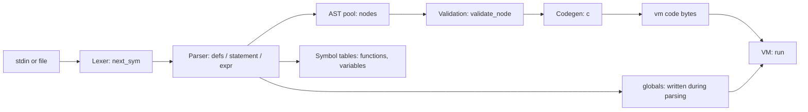

# Technical overview: compilation and VM execution in `tiny-c.c`

The compiler does not write an image file. It builds a bytecode array `vm[]` and fills `globals[]` in memory, then `run()` in `system.c` executes that array directly. The pipeline is:

## 1. Lexer

- `next_ch()` reads from `input_fp`, or stdin if it is null.
- `next_sym()` produces token codes such as `ID`, `INT`, `STRING_LITERAL`, and `RETURN_SYM`.
- Keywords are matched against `words[]`. `//` comments are skipped. Character and string literals support a fixed escape set.

## 2. Parser: builds an AST, not code

- `defs()` handles top-level globals and functions. `variable_declarations()` handles global scalars and arrays, including string initializers.
- `parse_function_definition()` records each function in `functions[]`, including its parameters, array flags, locals, and body. A function's index is assigned on first reference, so calls can precede definitions.
- Statements and expressions become `node` structs in the fixed pool `nodes[MAX_NODES]`. Each node has a `kind`, up to three children (`o1`, `o2`, `o3`), and a `val`.
- Locals are resolved to frame slots at parse time. Parameters use negative `val` (`-index-1`) to distinguish them from globals. Globals use absolute slot numbers in `globals[]`.
- Each `statement()` call builds one node tree, for example `IF1`, `WHILE`, `DO`, `SEQ`, `EXPR`, `RETURN_NODE`, or `VOID_RETURN`.
- Arithmetic operators (`+ - * / %`) have no precedence. `sum()` applies them strictly left to right, so `2 + 3 * 4` is `20`. Use parentheses to change the order. `expr()` accepts assignment only when the left side is `VAR`, `LOCAL`, or `ARRAY_GET`.
- Unary minus is lowered to `0 - term`. Integer literals are never negative.
- Comparison operators (`<`, `>`, `==`, `!=`) produce `1` when true and `0` when false.

## 3. Program-level checks (`program()`)

- A `main` must exist and must take no parameters.
- Every called function must be defined.
- Call arity is checked against each function's parameter count.
- `validate_node()` and `validate_call()` check that array references appear only as array arguments, and that array and scalar arguments match the parameter types.
- `returns_on_all_paths()` checks that `int` functions return on every path.
- `prog->o1` is set to `main`'s body.

Strings are lexed into `string_values[]`, then materialized during parsing. `allocate_string_literal()` reserves anonymous global storage laid out as `[length, chars..., 0]` and writes it directly into `globals[]`.

## 4. Code generation (`c()` walks the AST)

The output is a flat byte array `vm[MAX_CODE]` (65536 bytes). Opcodes are one byte, followed by fixed-size operands:

| Construct | Emitted code |
|---|---|
| Global read/write | `IFETCH` / `ISTORE` + 2-byte slot |
| Local read/write | `LLOAD` / `LSTORE` + 2-byte frame slot |
| Parameter read/write | `PLOAD` / `PSTORE` + 2-byte index |
| Array element | `IAFETCH`/`IASTORE` (global base) or `PAFETCH`/`PASTORE` (base taken from a parameter) |
| Constants | `IP1` (0 to 127), `IP2` (128 to 32767), `IP4` (larger) |
| Arithmetic and comparison | `IADD` to `INE` (operands already on the stack) |
| Control flow | `JZ`, `JNZ`, `JMP` with 2-byte signed relative offsets, patched via `hole()` and `fix()` |
| Call | `ICALL` + 2-byte address + 2-byte argc + 2-byte locals count (7 bytes total) |
| Return | `IRET` |
| Built-in `emit` | `SYS` + `SYS_EMIT` |

Notable generation details:

- Forward jumps are emitted as holes and patched once the target address is known. `WHILE` and `DO` back-jumps are emitted directly.
- Constant-only arithmetic and comparisons are folded at compile time by `fold()`. Division and modulo by zero are not folded, so they still fail at runtime.
- Call targets are unknown when the call is emitted, so each call is recorded in `call_fixups[]`. `patch_calls()` fills in the addresses after all functions are generated.
- Every function leaves exactly one value on the operand stack when it returns. An explicit `return;` in a `void` function and the implicit fall-through return both produce `0`. Calls used as statements discard the returned value with `IDROP`.
- Program layout: `PROG` emits a call to `main`, then `IDROP`, then `HALT`, then each function body in index order, each ending with `IRET`.

## 5. The "VM image" in memory

- `vm[]`: the code bytes, starting with the call to `main`.
- `globals[]`: global values. The C runtime zero-initializes this static array; parsing writes string initializer data into it.
- `num_global_slots`: the number of global slots in use.

`run()` in `tiny-c.c` starts the interpreter by:

1. Setting `pc = vm` and `sp = 0`.
2. Running the dispatch loop until `HALT`, or until `IRET` with an empty return stack.

Each call frame lives on the operand stack. Arguments are already pushed in order, so the frame starts at the first argument; local slots follow the arguments. These local slots are reserved by advancing `sp`, but are not initialized. A return-state struct records the return `pc` and the caller's `frame_base`.

## 6. How the VM runs

The VM is a stack machine implemented by `run()` in `tiny-c.c`. It has no separate loader or relocation step. The code it executes is the `vm[]` array produced by the compiler.

### Machine state

| State | Declaration | Purpose |
|---|---|---|
| Operand stack | `int st[1000]`, index `sp` | Holds intermediate values, call frames, and locals. `TOS` is `st[sp]`, `NOS` is `st[sp-1]`. |
| Globals | `globals[]` | Program-wide variables and arrays; static storage starts at zero, with string initializers written by the compiler. |
| Frame base | `frame_base` | Index in `st[]` of the current frame's first parameter or local. |
| Return stack | `struct return_s return_stack[1000]`, `return_sp` | Saved return `pc` and caller `frame_base` for each active call. |

### Dispatch loop

When `run()` is called from `system.c`, it sets `pc = vm` and `sp = 0`. The first instruction calls `main`.

- `run()` reads one opcode at `*pc++` and jumps to its case in a `switch`.
- `ACASE` is `goto again; case`, so each case ends by jumping back to the top of the loop.
- Operands follow the opcode inline and are decoded with `f2(pc)` (`*(short*)pc`) or `*(int*)pc` (4 bytes).
- Jumps are relative. `JMP`, `JZ`, and `JNZ` read a 2-byte offset (using f2(pc)) and add it to the operand address.
- `JZ` (JMP if zero) and `JNZ` (JMP if not zero) pop the condition from the stack. Zero means FALSE, non-zero means TRUE.

### Calls and returns

- `ICALL` reads the target address, argument count, and local count. It checks the call/operand stack limits, saves the return `pc` (`pc + 6`) and caller's `frame_base`, then sets `frame_base` to the first argument's slot (or the next free slot for a call with no arguments). The arguments are not copied: they remain in place on `st[]`. It reserves the local slots by advancing `sp`; **it does not zero them**. A local must be assigned before it is read; reading an uninitialized local has undefined behavior.
- `IRET` takes the function result from `TOS`, writes it to `st[frame_base]`, and sets `sp` to `frame_base`. This discards the frame's remaining arguments and locals while leaving the result in place as the call expression's value. It then restores the caller's `pc` and `frame_base`. This same return convention is used for integer results and the zero returned by void functions.
- A `return;` in a void function emits zero followed by `IRET`. If execution reaches the end of any function body, generated code likewise emits zero followed by `IRET`. Integer functions are checked by the parser for a return on all paths.
- `HALT` returns from `run()` directly.

### Built-in services

`SYS` followed by `SYS_EMIT` passes the top-of-stack value to `putchar` as a character. The stack value is replaced with `putchar`'s return value, so `emit` is an expression.

### Runtime checks

- Return-stack overflow (1000 entries) and call-frame/operand-stack overflow stop with an error.
- `IDIV` and `IMOD` stop on a zero divisor.
- `SYS_EMIT` expects one value on the stack; stack underflow is not checked.
- Array indexes are not checked at runtime, so a bad index reads or writes an arbitrary `globals[]` slot.
- Stack underflow is not checked for most opcodes.

## 7. Limitations

- **Jump range.** `fix()` rejects offsets outside the signed 16-bit range (about 32 KB), so a single `if`, `while`, or `do` body cannot exceed that size.
- **Fixed limits.**
  - `MAX_CODE` is 65536 bytes
  - `MAX_NODES` is 4096
  - `MAX_NAMES` is 1024 global names
  - `MAX_GLOBAL_SLOTS` is 256000 `int` slots
  - `MAX_STRING_LENGTH` is 1024 characters
  - `MAX_LOCALS` is 256 per function
  - `MAX_PARAMETERS` is 64 per function
  - the VM stack is 1000 entries.
- **Call addresses.** Call targets are 2-byte addresses, so `MAX_CODE` cannot exceed 65536 bytes.
