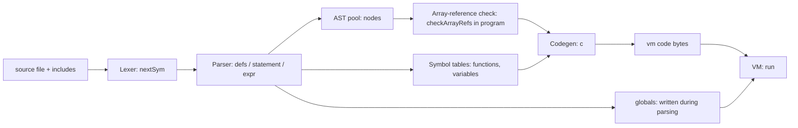

# Technical overview: compilation and VM execution

The compiler does not write an image file. It builds a bytecode array `vm[]` and fills `globalMem[]` in memory, then `run()` in `vm.c` executes that array directly. The pipeline is:

## Source layout

- `tiny-c.c`: defines the `main()` function.
- `tiny-c.h`: shared types, structures, sizes, and defines
- `lexer.c`: tokenization, global variable storage, the source/include stack, and error reporting.
- `parser.c`: AST nodes, function and variable tables, and program checks.
- `gen.c`: bytecode generation, constant folding, and call patching.
- `vm.c`: the `run()` interpreter.
- `listing.c`: the code listing. It is compiled only with `make LISTING=1`, and writes a listing of the generated code to `listing.txt`. `make listing-test` checks that listing against `listing-expected.txt`.
- `lib/*.tc`: Tiny-C source libraries included by programs, not C headers. `strcatc` does not check capacity, so the array must have room for the new character and the terminating zero. 

## 1. Lexer

- `nextCh()` reads from `inputFp`, or stdin if it is null, and counts newlines in `lineNumber`.
- `nextSym()` produces token codes such as `ID`, `INT`, `STRING_LITERAL`, `PLUS_PLUS`, and `RETURN_SYM`. `++` and `--` are single tokens, so `a--b` is a syntax error; write `a - -b`.
- Keywords are matched against `reservedWords[]`, and each keyword's token value is its index there, so `reservedWords[]` and the `*_SYM` enum in `tiny-c.h` must stay in the same order. `include` is a keyword, and when `nextSym()` sees it, it calls `includeFile()` instead of returning a token. Reserved words are `do`, `else`, `if`, `while`, `void`, `int`, `byte`, `emit`, `return`, and `include`. `emit` is a keyword, so using it as a name is a syntax error. Only `//` line comments are skipped. Character and string literals support a fixed escape set.
- `include "path";` is handled in the lexer. `includeFile()` splices the named file's text in place. Paths resolve relative to the including file's directory, and each joined path is read once. `closeSource()` returns to the includer at EOF.
- `fail()` prints `path:line:` before every compile error.
- The default input opened by `main()` is `unit-tests.tc`; a command-line path selects another input file.

## 2. Parser: builds an AST, not code

- `defs()` handles top-level globals and functions. `variableDeclarations()` handles global `int` and `byte` scalars and arrays, including string initializers. A global scalar initializer is parsed as an expression, converted for `byte` globals, and folded at parse time by `fold()` in `gen.c`; a non-constant initializer is a compile error.
- `parseFunctionDefinition()` records each function in `functions[]`, including its return type, parameter types and array flags, locals, and body. A prototype (a header ending in `;`) records the same signature without a body. A function's index is assigned on first reference, but a call must follow a prototype or definition of that function.
- Statements and expressions become `node` structs in the fixed pool `nodes[MAX_NODES]`. Each node has a `kind`, up to three children (`o1`, `o2`, `o3`), and a `val`.
- Locals are resolved to frame slots at parse time. Parameters use negative `val` (`-index-1`) to distinguish them from globals. Int and byte globals both live in `globalMem[]`, addressed by byte offset. Int scalars and int array elements take 4 bytes, read and written by `loadInt`/`storeInt`; byte globals and byte array elements take one byte each. The parser records each scalar or array element's `int`/`byte` type for conversions and array argument checks.
- Local slots follow the parameters in a function frame. Their encoded local index includes the function's parameter count; parameter indexes are relative to the start of the frame.
- Each `statement()` call builds one node tree, for example `IF1`, `WHILE`, `DO`, `SEQ`, `EXPR`, `RETURN_NODE`, or `VOID_RETURN`.
- A local declaration with an initializer becomes a `SET` to the local, wrapped in `EXPR` and sequenced with `SEQ`. `byte` locals convert the value first. The initializer runs each time the declaration executes, so it works inside loops.
- Arithmetic operators (`+ - * / %`) have no precedence. `sum()` applies them strictly left to right, so `2 + 3 * 4` is `20`. Use parentheses to change the order. Assignment is a statement, not an expression: `statement()` parses an expression, and if it is followed by `=`, `assignment()` requires a `VAR`, `LOCAL`, or `ARRAY_GET` target. `a = b = 1;`, `if (a = 1)`, and `emit(a = 1)` are syntax errors.
- Unary minus is lowered to `0 - term`. Integer literals are never negative.
- `x++`, `x--`, `++x`, and `--x` apply to scalar locals, parameters, and globals. The parser builds `POST_INC` or `PRE_INC` nodes; postfix yields the old value and prefix the new. Applying them to arrays or literals is an error.
- Comparison operators (`<`, `>`, `<=`, `>=`, `==`, `!=`) produce `1` when true and `0` when false.

## 3. Program-level checks (`program()`)

- A `main` must exist, must take no parameters, and must return `int` or `void`.
- Every declared function must be defined. A call must follow a prototype or definition of its function.
- A repeated prototype or definition must match the earlier declaration's return type, parameter types, and array flags; parameter names may differ.
- A global variable and a function may have the same name. `f = ...` assigns the variable and `f(...)` calls the function.
- Parse errors report the line the lexer has reached, which can be one line past the offending token when that token ends a line. Errors found after parsing (validation and code generation, for example a void call used as a value) report the position where parsing stopped, not the offending line.
- `callArguments()` checks call arity, argument kinds (scalar or array), and array element types against the callee's declared signature.
- `checkArrayRefs()` rejects array references anywhere except as direct array arguments.
- `returnsOnAllPaths()` checks that `int` and `byte` functions return on every path. Only `return`, statement sequences, `if`/`else`, and `do` bodies count; a `while` loop never does, so `while (1) { return 1; }` is rejected.
- `prog->o1` is set to `main`'s body.

Strings are lexed into `stringValues[]`, then materialized during parsing. `allocateStringLiteral()` reserves anonymous global byte storage laid out as `[length low byte, length high byte, chars..., 0]` and writes it directly into `globalMem[]`.
String literals are permitted only as array arguments or global array initializers. Explicitly sized string-initialized arrays must fit the 2-byte length, all characters, and the terminating zero.

## 4. Code generation (`c()` walks the AST)

The output is a flat byte array `vm[MAX_CODE]` (65536 bytes) of register instructions. Each opcode is one byte, followed by operands in the order given by the layout comment in `tiny-c.h`:

- `r`: a 2-byte unsigned register number, relative to the current frame.
- `a`: a 4-byte address or immediate.
- `t`: a 4-byte jump offset, counted from the offset field itself.

| Construct | Emitted code |
|---|---|
| Constant | `LDI r, a` |
| Local or parameter | No instruction for a read: the value stays in its register. Parameters are registers `0..numParameters-1`, locals follow them, and temporaries follow the locals. `MOV r, r` copies when a value must move. |
| Global `int` read/write | `IGET` / `ISET` (`r, a`) |
| Global `byte` read/write | `BGET` / `BSET` (`r, a`) |
| Global `int` `++`/`--` | `IINC` (`r, a, delta`) gives the new value in `r`; `IINCP` gives the old value. One op in every context; a discarded result goes to a scratch register. |
| Global `byte` `++`/`--` | `BINC` / `BINCP` (`r, a, delta`), same as the int forms, with the byte truncation. |
| Int array element, global base | `IAGET` / `IASET` (`r, a, index`); the VM scales the index by 4. A constant index folds into the address. |
| Byte array element, global base | `BAGET` / `BASET` (`r, a, index`); unscaled |
| Array element, base from a parameter | `PIAGET` / `PIASET` / `PBAGET` / `PBASET` (`r, base, index`), where the base register holds an address |
| Arithmetic and comparison | `IADD`, `ISUB`, `IMUL`, `IDIV`, `IMOD`, `ILT`, `IGT`, `ILE`, `IGE`, `IEQ`, `INE` (`r, r, r`). `IADDI` (`r, r, a`) covers `+` and `-` with a constant operand. |
| Byte conversion | `I2B` (`r, r`) narrows to unsigned 8-bit `byte` (0 to 255) |
| Control flow | `JMP t`, `JZ r, t`, `JNZ r, t`, patched via `hole()` and `fix()`. A comparison used as a condition becomes one fused branch: `JLT`, `JGT`, `JEQ`, `JNE`, `JGE`, `JLE` (`r, r, t`), which compare two registers and jump in one dispatch. |
| Call | `CALL a, r, frameSize` (10 bytes). The callee's frame starts at the caller's register `r`. |
| Return | `RET r` returns a register; `RET0` returns 0 |
| Built-in `emit` | `EMIT r, s` (`r` receives `putchar`'s result) |
| Program end | `HALT`, after the call to `main` |

Notable generation details:

- Registers are allocated per statement. Named variables use fixed registers, and temporaries are reset at the end of each statement, so they are reused.
- A callee's parameters are evaluated directly into the caller's registers starting at the `CALL` base, so arguments are not copied. The result comes back in that base register.
- When the right operand of a binary operator has side effects (assignment, `++`/`--`, or an array store), a register-resident left operand is first copied to a temporary, which keeps left-to-right evaluation.
- Forward jumps are emitted as holes and patched once the target address is known. `WHILE` and `DO` back-jumps are emitted directly.
- Constant-only arithmetic and comparisons are folded at compile time by `fold()`. Division and modulo by zero are not folded, so they still fail at runtime.
- Call targets are unknown when the call is emitted, so each call is recorded in `callFixups[]`. `patchCalls()` fills in each call's address and the callee's frame size after all functions are generated.
- A `return;` in a `void` function emits `RET0`, and falling off the end of a function also emits `RET0`, so both return `0`. Calls used as statements discard the returned value.
- Program layout: `CALL main` at base register 0, then `HALT`, then each function body in index order, each ending with `RET0`.
- Immediates and operands are 2-byte registers, 4-byte addresses, immediates, and jump offsets, in native byte order. The bytecode assumes a 32-bit `int`.

## 5. The "VM image" in memory

- `vm[]`: the code bytes, starting with the call to `main`.
- `globalMem[]`: all global `int` and `byte` storage, addressed by byte offset. The C runtime zero-initializes this static array. Parsing writes string and scalar initializer data into it.
- `numGlobalBytes`: the number of bytes in use in `globalMem[]`.
- VM values use C `int` (32 bits on the configured Linux and Visual Studio targets), and global `int` values are 4 bytes in `globalMem[]`. `byte` values are unsigned 8-bit values (0 to 255). Global `byte` storage is byte-sized in `globalMem[]`; `byte` locals and parameters are held in `int` registers. Generated conversions narrow on assignment, parameter passing, return, and array stores, while reads promote back to `int`. Character literals remain int-valued, and casts are not supported. Scalar initializers are supported: global ones are folded at parse time, and local ones compile to assignments at the declaration point.

`run()` in `vm.c` starts the interpreter by:

1. Setting `pc = vm`, `frameBase = 0`, and `returnSp = 0`.
2. Running the dispatch loop until `HALT`, or until `RET`/`RET0` with an empty return stack.

Each call frame is a window of registers in `st[]` that starts at `frameBase`. The caller computes arguments directly into its registers at the `CALL` base, so the callee's parameters are already in place. Locals and temporaries follow them in the same frame. The return-state struct records the return `pc` and the caller's `frameBase`.

## 6. How the VM runs

The VM is a register machine implemented by `run()` in `vm.c`. It has no separate loader or relocation step. The code it executes is the `vm[]` array produced by the compiler.

### Machine state

| State | Declaration | Purpose |
|---|---|---|
| Registers | `int st[STACK_SIZE]` (4096) | Holds every active frame's registers. Register `n` of the current frame is `st[frameBase + n]`. |
| Globals | `globalMem[]` | Program-wide `int` variables and arrays, 4 bytes per element; static storage starts at zero. |
| Byte globals | `globalMem[]` | Program-wide `byte` variables and arrays, one byte per element; string initializers are written by the compiler. |
| Frame base | `frameBase` | Index in `st[]` of the current frame's register 0. |
| Return stack | `struct return_s returnStack[STACK_SIZE]` (4096), `returnSp` | Saved return `pc` and caller `frameBase` for each active call. |

### Dispatch loop

- `run()` reads one opcode at `*pc++` and jumps to its case in a `switch`.
- `ACASE` is `goto again; case`, so each case ends by jumping back to the top of the loop.
- Operands follow the opcode inline. Register operands are read with `regIndex()` (a 2-byte unsigned value) and used through the `REG(p)` macro. Addresses and immediates are read with `f4(pc)` (`*(int*)pc`).
- Jumps are relative to the offset field. `JMP` reads a 4-byte offset and adds it to the field's address. `JZ r, t` and `JNZ r, t` test register `r` and jump when it is zero (or non-zero). The fused branches take two register operands and a jump offset, and jump when their comparison holds. `if`, `while`, and `do` use the inverse of the condition for the jump past the body, so `a < b` branches with `JGE` when false.

### Calls and returns

- `CALL a, r, frameSize` computes `newBase = frameBase + r` and checks that the return stack has room and that `newBase + frameSize` fits in `st[]`. It saves the return `pc` (the instruction after the 10-byte `CALL`) and the caller's `frameBase`, then sets `frameBase = newBase` and jumps to `a`. No arguments are copied: they are already in the callee's first registers.
- `RET r` stores register `r` into `st[frameBase]`, which is the callee's register 0 and the caller's register `r`. It then restores the caller's `pc` and `frameBase`. `RET0` does the same with `0`. Registers above the callee's frame are not cleared, and a local must be assigned before it is read; reading an unassigned local has undefined behavior.
- `HALT` returns from `run()`.

### Built-in services

`EMIT r, s` passes register `s` to `putchar` as a character and stores its return value in register `r`, so `emit` is an expression.

### Runtime checks

- Call-stack overflow (more than `STACK_SIZE` nested calls) and call-frame overflow (a frame that would extend past `STACK_SIZE` slots) stop with an error at `CALL`.
- `IDIV` and `IMOD` stop on a zero divisor.
- Array indexes are not checked at runtime, so a bad index reads or writes an arbitrary `globalMem[]` byte.
- Register operands are not range-checked at runtime; the code generator keeps them within the frame.

## 7. Limitations

- **Fixed limits.**
  - `ID_NAME_LENGTH` is 64. Used for variable and parameter names.
  - `MAX_CODE` is 65536 bytes.
  - `MAX_NODES` is 16384 AST nodes.
  - `MAX_FUNCTIONS` is 1024 functions.
  - `MAX_GLOBAL_NAMES` is 2048 global variable names.
  - `MAX_GLOBAL_BYTES` is 2097152 bytes, shared by `int` and `byte` globals.
  - `MAX_STRING_LENGTH` is 1024 characters.
  - `MAX_LOCALS` is 256 per function.
  - `MAX_PARAMETERS` is 64 per function.
  - `MAX_CALL_FIXUPS` is the same as `MAX_NODES`.
  - `MAX_PATH_LENGTH` is 64 chars.
  - `MAX_INCLUDE_DEPTH` is 16.
  - `MAX_INCLUDED_FILES` is 128.
  - `STACK_SIZE` is 4096 slots. All active frames' registers share this array, and the return stack has 4096 entries. Each call uses `frameSize` slots, so the usable recursion depth depends on how many registers each function needs.
  - `MAX_REGISTERS` is 65535 registers per function frame, the limit of a 2-byte register operand.

- **Local variables.** Locals are scalars only. Local arrays are not supported.
